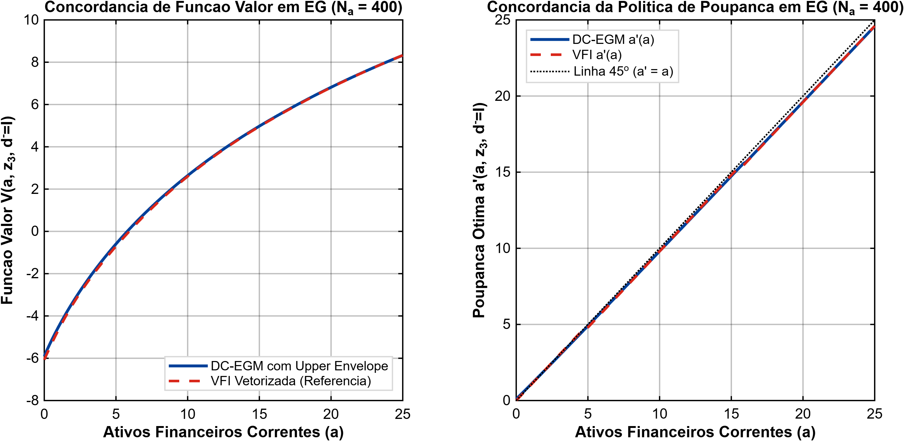
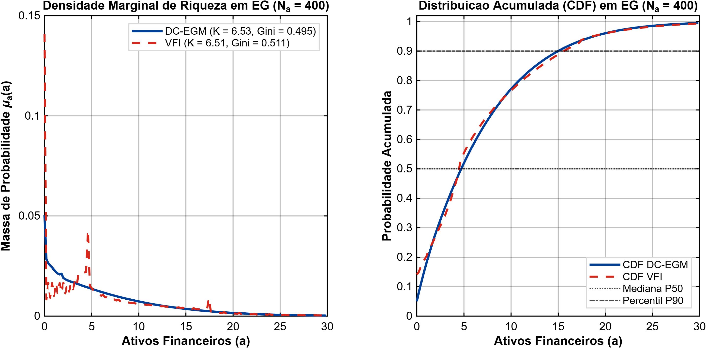

## Introdução e Motivação

A macroeconomia quantitativa com modelos de agentes heterogêneos e mercados incompletos (na tradição de Bewley, Huggett e Aiyagari) defronta-se frequentemente com uma barreira computacional severa: a maldição da dimensionalidade. Quando os modelos incorporam escolhas discretas (como participação no mercado de trabalho, formalidade versus informalidade ou aposentadoria) juntamente com acumulação contínua de riqueza, a função valor deixa de ser globalmente côncava e suave.

Tradicionalmente, a literatura recorre à **Iteração da Função Valor (VFI)** com busca exaustiva sobre grades discretas em $(a, a')$, cujo custo cresce rapidamente com a resolução da malha e onera a busca pelo equilíbrio geral dos preços de fatores.

Neste projeto de pesquisa, implementamos e comparamos dois métodos numéricos em um modelo canônico discreto-contínuo:
1. **Value Function Iteration (VFI)** vetorizada clássica;
2. **Discrete-Continuous Endogenous Grid Method (DC-EGM)** estendido com poda geométrica por **Upper Envelope** (Iskhakov et al., 2017).

Investigamos o comportamento do DC-EGM sob escolhas ocupacionais puramente **determinísticas** ($s_\varepsilon = 0$) e **custos fixos de transição ocupacional** ($\bar\chi = 0{,}05$). Os experimentos registram ganhos de desempenho de até **7,65x** em equilíbrio parcial ($N_a = 1600$) e **3,49x** em equilíbrio geral ($N_a = 400$), além da ocorrência de dobras na grade endógena a partir de $N_a = 800$ no experimento de equilíbrio parcial.

---

## Ambiente Econômico e Problema Dinâmico

A economia é habitada por um contínuo de famílias heterogêneas e uma firma representativa com tecnologia Cobb-Douglas em equilíbrio competitivo estacionário:

- **Preferências:** Função utilidade CRRA $u(c) = \frac{c^{1-\sigma} - 1}{1 - \sigma}$ com aversão relativa ao risco $\sigma = 2{,}00$ e fator de desconto intertemporal $\beta = 0{,}96$.
- **Decisão Contínua:** Poupança ótima em ativos líquidos $a' \in [0, \bar{a}]$ com $\bar{a} = 80{,}00$, sujeita à restrição estrita de endividamento (*borrowing constraint*).
- **Decisão Discreta Ocupacional ($d \in \{N, I, F\}$):**
  - $d = N$: Inatividade ($y_N = 0$, desutilidade $\psi_N = 0{,}00$);
  - $d = I$: Setor Informal ($y_I(z) = \kappa w z$, com $\kappa = 0{,}72$, sem tributação, desutilidade $\psi_I = 0{,}05$);
  - $d = F$: Setor Formal ($y_F(z) = (1 - \tau) w z$, com $\tau = 0{,}20$, desutilidade $\psi_F = 0{,}08$).
- **Fricção de Mercado:** Custo fixo de transição $\chi(d, d^-) = \bar\chi \cdot \mathbf{1}_{\{d \neq d^-\}}$, com $\bar\chi = 0{,}05$ em unidades de utilidade.
- **Risco Idiossincrático:** Produtividade $z$ governada por processo AR(1) em log discretizado via método de Rouwenhorst com persistência $\rho = 0{,}90$, desvio-padrão da inovação $\sigma_\varepsilon = 0{,}20$ e $N_z = 5$ estados (normalizados para $\mathbb{E}[z] = 1$).
- **Tecnologia Agregada:** Função de produção $Y = A K^\alpha L^{1-\alpha}$ com $A = 1{,}00$, $\alpha = 0{,}36$ e depreciação anual $\delta = 8\%$.

### O Problema Intertemporal do Agente

Como a escolha ocupacional corrente implica custo de transição caso difira do estado anterior, a ocupação passada $d^-$ integra o vetor de estados individuais $(a, z, d^-)$. O problema recursivo do agente escreve-se como:

$$V(a, z, d^-) = \max_{d \in \{N, I, F\}} \left\{ v_d(a, z, d^-) \right\}$$

em que, condicionada a cada alternativa discreta $d$, a função valor contínua satisfaz:

$$v_d(a, z, d^-) = \max_{a' \in [0, \bar{a}]} \left\{ u(c) - \psi_d - \chi(d, d^-) + \beta\,\mathbb{E}\left[ V(a', z', d) \mid z \right] \right\}$$

sujeito à restrição orçamentária e à positividade do consumo:

$$c + a' = (1 + r)a + y_d(z), \qquad c > 0.$$

---

## Métodos Numéricos e Diagnóstico de Não-Concavidade (EP vs. EG)

Para cada escolha discreta $d \in \{N, I, F\}$ e estado exógeno $z$, o método inverte analiticamente a Equação de Euler sobre a grade de ativos futuros $a'$, definindo os pontos endógenos:

$$a_{\text{endog}}(a') = \frac{(u')^{-1}\!\left(\beta (1+r) \mathbb{E}\left[V_a(a', z', d) \mid z\right]\right) + a' - y_d(z)}{1+r}.$$

A solução por DC-EGM estrutura-se em três etapas encadeadas:
1. Resolve separadamente o problema contínuo condicionado a cada alternativa discreta $d \in \{N, I, F\}$, sem otimização numérica sobre $a'$.
2. Os custos fixos de transição $\bar\chi$ e o operador $\max_d$ geram cruzamentos entre as funções valor condicionais $v_d(a)$, produzindo **pontos de quina** (*kinks*) nos limiares de indiferença setorial e regiões locais onde $V$ perde concavidade ($\Delta^2 V > 0$), como ilustra a Figura 1.
3. Quando $\mathbb{E}[V_a']$ deixa de ser monotônica, $a_{\text{endog}}(a')$ inverte o sentido ($d a_{\text{endog}}/d a' < 0$) e gera múltiplos ramos; o algoritmo de **Upper Envelope** não é apenas uma etapa auxiliar de velocidade, mas uma exigência geométrica para identificar segmentos subótimos, podá-los e preservar a envoltória eficiente global.

  
  
<em>Figura 1: Funções valor condicionais e envelope superior exibindo quinas nos pontos de indiferença ocupacional.</em>

  
  
<em>Figura 3: Diagnóstico das grades endógenas em equilíbrio parcial sob custos fixos de transição ocupacional.</em>

  
  
<em>Figura 14: Anatomia do algoritmo Upper Envelope na dobra interior ($z_2, d=I, N_a=1600$), destacando o descarte de ramos subótimos.</em>

**Contraste entre Equilíbrio Parcial e Equilíbrio Geral:** Os experimentos de equilíbrio parcial ($r = 4{,}1667\%$, $w = 1{,}1781$) identificam dobras na grade endógena a partir de $N_a = 800$, com aumento de ocorrências sob refinamento da discretização: nenhuma dobra discreta em $N_a = 400$, duas dobras em $N_a = 800$ e quatro dobras em $N_a = 1600$ (três interiores em torno de $a' \approx 60{,}5$, $64{,}5$ e $74{,}4$ e uma próxima à fronteira superior em $a' \in [78{,}55;\, 80{,}0]$). Entretanto, essas dobras não são uma propriedade universal da parametrização: na solução de equilíbrio geral examinada com $N_a = 400$ ($r^* \approx 2{,}80\%$), todas as grades endógenas permaneceram estritamente monotônicas, com incrementos mínimos positivos de $+0{,}1583$ na inatividade, $+0{,}1237$ na informalidade e $+0{,}1313$ na formalidade.

---

## Resultados Computacionais e Escalabilidade

### 1. Refinamento Multigrade no Modelo Canônico ($\bar\chi = 0{,}05$, EP)

| $N_a$ | Iter. (VFI / DC) | Conv. DC ($10^{-7}$) | VFI (s) | DC-EGM (s) | Speedup | Conc. $d^*$ | Dobras |
| :---: | :---: | :---: | :---: | :---: | :---: | :---: | :---: |
| 400 | 376 / 1.500 | Não (teto) | 2,914 | 4,990 | 0,58x | 99,27 % | 0 |
| 800 | 376 / 376 | Sim | 10,591 | 2,530 | 4,19x | 99,78 % | 2 |
| 1.600 | 376 / 376 | Sim | 39,749 | 5,199 | **7,65x** | **99,97 %** | 4 |

- Na malha básica ($N_a = 400$), o DC-EGM atinge o teto de 1.500 iterações com resíduo final de Cauchy $\|\Delta V\|_\infty = 2{,}09 \times 10^{-6}$ (acima da tolerância de $10^{-7}$, e $\|\Delta c\|_\infty = 5{,}80 \times 10^{-4}$), resultando em tempo superior ao da VFI (`0,58x`).
- A partir de $N_a = 800$, ambos convergem em 376 iterações; em $N_a = 1600$ (24.000 pontos no espaço de estados), o DC-EGM cai de **39,75 s** para **5,20 s** (**speedup de 7,65x**), mantendo concordância ocupacional de **99,97%** e diferenças em norma do supremo $\|\Delta V\|_\infty = 0{,}0156$ e $\|\Delta c\|_\infty = 0{,}0525$.

  
  
<em>Figura 12: Mapa espacial de escolha ocupacional ótima $d^*(a, z, d^-)$ e regiões de histerese ($N_a = 1600$, concordância de 99,97% com a VFI).</em>

### 2. Benchmark Histórico Complementar ($\bar\chi = 0$, Modelo Preliminar)

Em experimento complementar separado sobre o modelo preliminar **sem custos de transição** ($\bar\chi = 0$, $N_a = 400$), o **DC-EGM Otimizado** obtém mediana de **1,661 s** (`4,23x` mais rápido que a VFI vetorizada de referência) e resíduo médio na Equação de Euler de **$7{,}18 \times 10^{-7}$**, frente a **$1{,}88 \times 10^{-3}$** mesmo na VFI refinada com 3.200 pontos candidatos (`91,149 s`).

> **Ressalva metodológica:** Esses valores de erro de Euler pertencem exclusivamente ao benchmark preliminar sem custos de transição ($\bar\chi = 0$) e não devem ser interpretados como medida direta de acurácia do modelo canônico ($\bar\chi = 0{,}05$). Na presença de escolhas discretas e não-concavidades locais, a precisão numérica exige avaliação diferenciada nas vizinhanças de restrições de liquidez e limiares de transição ocupacional.

  
  
<em>Figura 16: Benchmark histórico complementar ($\bar\chi = 0$, modelo preliminar): fronteira tempo de execução versus erro médio de Euler entre 9 implementações.</em>

---

## Equilíbrio Geral Competitivo e Distribuição Estacionária ($N_a = 400$)

Os dois métodos produzem agregados macroeconômicos bastante próximos: as diferenças relativas são inferiores a **$0{,}5\%$** nas variáveis reais analisadas, à exceção da taxa real de juros ($r^*$), cuja discrepância é de **$0{,}633\%$** ($1{,}8\text{ pb}$). As diferenças distributivas são maiores, destacando-se o coeficiente de Gini da riqueza (**$3{,}38\%$**) e a fração concentrada na restrição de crédito.

| Variável / Critério | DC-EGM | VFI Vetorizada | Discrepância / Status |
| :--- | :---: | :---: | :---: |
| Razão Capital-Trabalho ($k^*$) | 6,564697 | 6,547806 | 0,258 % |
| Taxa Real de Juros ($r^*$) | 2,7966 % | 2,8144 % | 0,633 % (1,8 pb) |
| Salário Real Competitivo ($w^*$) | 1,260020 | 1,258851 | 0,093 % |
| Estoque Agregado de Capital ($K^*$) | 6,5349 | 6,5147 | 0,310 % |
| Trabalho Efetivo Agregado ($L^*$) | 0,9956 | 0,9947 | 0,090 % |
| Produto Agregado ($Y^*$) | 1,9600 | 1,9567 | 0,169 % |
| Consumo Agregado ($C^*$) | 1,1892 | 1,1885 | 0,055 % |
| Investimento Agregado ($I^*$) | 0,5228 | 0,5212 | 0,309 % |
| Gasto do Governo ($G^*$) | 0,2480 | 0,2470 | 0,418 % |
| Coeficiente de Gini de Riqueza | 0,4948 | 0,5115 | 3,38 % |
| Participação no Setor Formal ($M_F$) | 98,28 % | 97,96 % | 0,32 pp |
| Resíduo Relativo de Mercado ($\lvert f(k)\rvert/k$) | $9{,}76 \times 10^{-5}$ | $2{,}88 \times 10^{-4}$ | Tol. $10^{-4}$: Sim (DC) / Não (VFI) |
| Resíduo Contábil de Walras | $-1{,}68 \times 10^{-8}$ | $-2{,}47 \times 10^{-8}$ | Consistência contábil |
| **Tempo Total em EG (Iter.)** | **7,61 s (11 iter.)** | **26,60 s (15 iter.)** | **3,49x mais rápido** |

**Critérios de fechamento do equilíbrio geral:** Embora produzam agregados próximos, os algoritmos não encerram com a mesma precisão no fechamento do mercado de capitais. Em `equilibrio_geral_dc_egm.m`, a bisseção encerra exclusivamente pelo excesso de oferta de capital ($|f(k)|/k < 10^{-4}$ ou $|f(k)| < 10^{-4}$), atingindo $9{,}76 \times 10^{-5}$ na 11ª iteração. Em `equilibrio_geral_vfi.m`, há uma condição adicional de largura do intervalo ($|k_b - k_a| < 10^{-4}$), o que encerra a busca na 15ª iteração pela contração do intervalo $[k_a, k_b]$, com resíduo relativo de mercado ainda em $2{,}88 \times 10^{-4}$ (acima da tolerância de $10^{-4}$). O resíduo de Walras ($Y - C - I - G$) verifica apenas a identidade contábil das restrições orçamentárias e produtivas, não substituindo a condição de equilíbrio do mercado de capitais.

  
  
<em>Figura 4: Comparação entre VFI e DC-EGM na função valor $V(a,z,d^-)$ e na política de poupança $a'(a,z,d^-)$ em equilíbrio geral (malha uniforme $a \in [0, 80]$).</em>

  
  
<em>Figura 11: Políticas ótimas de consumo $c^*(a)$ e poupança líquida $a'(a)-a$ ($N_a=1600$), evidenciando suavização precaucional e restrição de liquidez.</em>

  
  
<em>Figura 6: Densidade marginal estacionária de ativos exibindo a concentração de massa na restrição $a=0$.</em>

- **Concentração na Base:** A distribuição estacionária obtida via método de Young (2010) apresenta massa relevante acumulada na restrição de liquidez $a = 0$ ($5{,}03\%$ no DC-EGM e $14{,}09\%$ na VFI em equilíbrio geral). Essa concentração reflete a interação entre a heterogeneidade de produtividade, as decisões ocupacionais discretas e as políticas ótimas de poupança, explicando também a diferença nos índices de Gini ($0{,}4948$ vs. $0{,}5115$).
- **Composição Ocupacional (EP $\to$ EG):** Sob os preços iniciais de equilíbrio parcial ($r = 4{,}1667\%$, $w = 1{,}1781$), a informalidade concentra $86{,}99\%$ dos agentes. Nos preços competitivos de equilíbrio geral ($w^* = 1{,}2600$, $r^* = 2{,}80\%$), a participação formal eleva-se para $98{,}28\%$ no DC-EGM ($97{,}96\%$ na VFI). Esse percentual próximo de $98\%$ é uma propriedade numérica da parametrização e dos preços competitivos adotados no modelo, não devendo ser interpretado como estimativa empírica da composição ocupacional observada no Brasil.

---

## Laboratório Numérico Interativo (JS/HTML)

Explore diretamente no navegador as funções políticas de equilíbrio geral, as dobras não côncavas detectadas no *Upper Envelope* ($N_a = 1600$), a distribuição estacionária de riqueza e o *benchmark* de escalabilidade e erros de Euler — alimentados pelos dados numéricos reais exportados do modelo em MATLAB.

<noscript>Ative o JavaScript para usar o visualizador numérico interativo de VFI vs. DC-EGM.</noscript>

---

## Limitações do Estudo

1. **Dependência da discretização em $N_a = 400$:** No experimento de equilíbrio parcial, o DC-EGM atingiu o limite de 1.500 iterações com diferença de $2{,}09 \times 10^{-6} > 10^{-7}$, alcançando convergência estrita apenas a partir de $N_a = 800$.
2. **Não-concavidade sensível a preços e malha:** A ocorrência de dobras na grade endógena manifestou-se no experimento de EP ($N_a \in \{800, 1600\}$), mas esteve ausente na solução de EG examinada com $N_a = 400$.
3. **Acurácia não uniforme:** Sob custos de transição ($\bar\chi = 0{,}05$), erros numéricos variam pelo espaço de estados e tendem a concentrar-se próximo à restrição $a = 0$ e aos limiares de mudança ocupacional.
4. **Natureza empírica do benchmark:** Os tempos medidos refletem esta implementação vetorizada específica em MATLAB e não constituem prova de complexidade assintótica universal.
5. **Refinamento conjunto na VFI:** No comparativo multigrade, o aumento de $N_a$ refina simultaneamente estado ($a$) e controle ($a'$), acentuando o custo quadrático da busca discreta frente ao custo linear do DC-EGM.
6. **Calibração ilustrativa:** Os agregados e participações setoriais decorrem da parametrização canônica definida, sem estimação econométrica aplicada à economia brasileira.

---

## Materiais Didáticos, Reprodutibilidade e Downloads

Projeto validado em **MATLAB R2026b Update 1** (compatível com R2020b+), com ponto de entrada único `executar_projeto.m` na raiz de `ENTREGA_PROFESSOR/` e bateria de **11 testes automatizados** formais aprovados (`log_execucao_modelo.txt`). Os slides e os códigos-fonte do pacote publicado estão disponíveis abaixo:

- 📊 **[Slides de Apresentação Executiva Beamer 16:9 (PDF)](../materials/dc_egm_vfi/APRESENTACAO_FINAL.pdf)**: Versão executiva (18 slides).
- 🖥️ **[Slides — Apresentação Completa Beamer 16:9 (PDF)](../materials/dc_egm_vfi/APRESENTACAO_COMPLETA.pdf)**: Versão expandida com teoria, KKT, implementação MATLAB e figuras (45 slides).
- 📦 **[Códigos MATLAB (.zip)](../materials/dc_egm_vfi/CODIGOS_ENTREGA_PROFESSOR.zip)**: Estrutura modular com ponto de entrada único `executar_projeto.m` na raiz e subpastas temáticas (`parametros/` e `codigos/`).

---

## Referências Bibliográficas

1. **Aiyagari, S. R. (1994).** Uninsured Idiosyncratic Risk and Aggregate Saving. *Quarterly Journal of Economics*, 109(3), 659–684.
2. **Carroll, C. D. (2006).** The Method of Endogenously Constrained Grids for Solving Dynamic Stochastic Optimization Problems. *Economics Letters*, 91(3), 312–320.
3. **Huggett, M. (1993).** The Risk-Free Rate in Heterogeneous-Agent Incomplete-Insurance Economies. *Journal of Economic Dynamics and Control*, 17(5-6), 953–969.
4. **Iskhakov, F., Jørgensen, T. H., Rust, J., & Schjerning, B. (2017).** The Endogenous Grid Method for Discrete-Continuous Dynamic Choice Models with (or without) Taste Shocks. *Quantitative Economics*, 8(2), 317–365.
5. **Young, E. R. (2010).** Solving the Incomplete Markets Model with Aggregate Uncertainty Using the Krusell-Smith Algorithm and Non-Stochastic Simulations. *Journal of Economic Dynamics and Control*, 34(1), 36–41.
