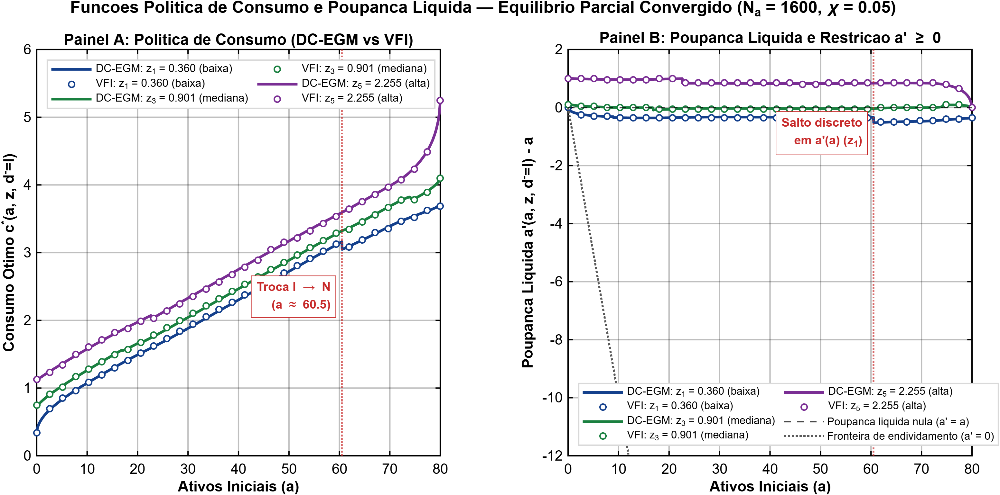
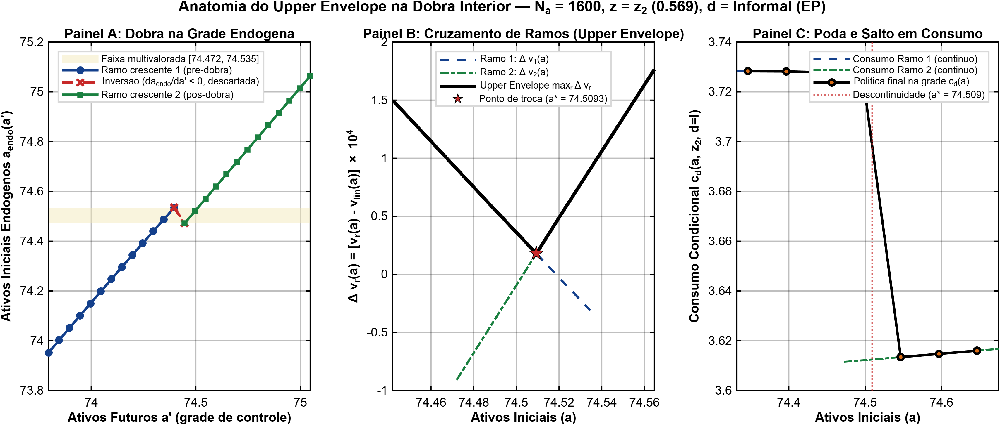
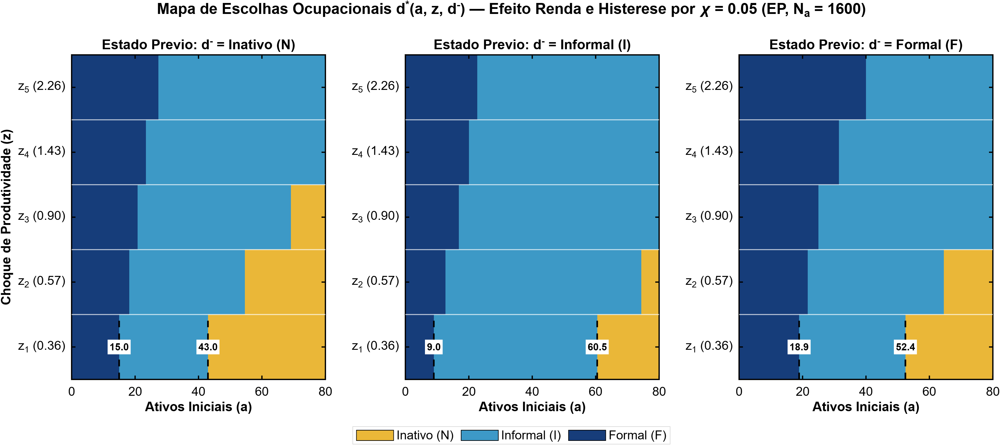

## Introdução e Motivação

A macroeconomia quantitativa com modelos de agentes heterogêneos e mercados incompletos (na tradição de Bewley, Huggett e Aiyagari) defronta-se frequentemente com uma barreira computacional severa: a maldição da dimensionalidade. Quando os modelos incorporam escolhas discretas (como participação no mercado de trabalho, formalidade versus informalidade ou aposentadoria) juntamente com acumulação contínua de riqueza, a função valor deixa de ser globalmente côncava e suave.

Tradicionalmente, a literatura recorre à **Iteração da Função Valor (VFI)** com busca exaustiva sobre grades discretas em $(a, a')$, cujo custo cresce rapidamente com a resolução da malha e onera a busca do equilíbrio geral de preços de fatores. 

Neste projeto de pesquisa, desenvolvemos, implementamos e comparamos de forma rigorosa dois métodos numéricos em um modelo canônico:
1. **Value Function Iteration (VFI)** vetorizada clássica;
2. **Discrete-Continuous Endogenous Grid Method (DC-EGM)** estendido com poda geométrica por **Upper Envelope** (Iskhakov et al., 2017).

Investigamos empiricamente o comportamento do DC-EGM sob escolhas ocupacionais puramente **determinísticas** ($s_\varepsilon = 0$) e **custos fixos de transição ocupacional** ($\bar\chi = 0{,}05$), comprovando a persistência de dobras interiores, acelerações de até 7,65x em equilíbrio parcial ($N_a=1600$) e 3,49x em equilíbrio geral ($N_a=400$), além de resíduos da Equação de Euler inferiores a $10^{-6}$ no benchmark histórico preliminar ($\bar\chi = 0$).

---

## O Modelo Econômico

O modelo é composto por um contínuo de famílias heterogêneas e uma firma representativa com tecnologia Cobb-Douglas em equilíbrio competitivo estacionário:

- **Decisão Contínua:** Poupança ótima em ativos líquidos $a' \ge 0$, sujeita à restrição estrita de endividamento (*borrowing constraint*).
- **Decisão Discreta Ocupacional ($d \in \{N, I, F\}$):**
  - $d = N$: Inatividade ($y_N = 0$, desutilidade $\psi_N = 0{,}00$);
  - $d = I$: Setor Informal ($y_I = \kappa w z$, com $\kappa = 0{,}72$, sem tributação, desutilidade $\psi_I = 0{,}05$);
  - $d = F$: Setor Formal ($y_F = (1 - \tau) w z$, com $\tau = 0{,}20$, desutilidade $\psi_F = 0{,}08$).
- **Fricção de Mercado:** Custo fixo de transição $\chi(d, d_{-1}) = \bar\chi \cdot \mathbf{1}_{\{d \neq d_{-1}\}}$ com $\bar\chi = 0{,}05$ em utilidade.
- **Risco Idiossincrático:** Produtividade $z$ governada por processo AR(1) em log discretizado por Rouwenhorst com persistência $\rho = 0{,}90$ e dispersão $\sigma_\varepsilon = 0{,}20$.
- **Tecnologia Agregada:** $Y = K^\alpha L^{1-\alpha}$ ($\alpha = 0{,}36$, $\delta = 8\%$).

---

## O Desafio da Não-Concavidade e o Upper Envelope

A presença do custo de transição $\bar\chi = 0{,}05$ e das escolhas discretas gera cruzamentos entre as funções valor condicionais $v_d(a)$. A função valor global:
$$V(a, z, d_{-1}) = \max_{d \in \{N, I, F\}} v(a, z, d, d_{-1})$$
apresenta pontos de quina (*kinks*) e regiões locais de convexidade ($\Delta^2 V > 0$).

Ao inverter analiticamente a Equação de Euler via EGM para cada escolha $d$:
$$a_{\text{endog}}(a') = \frac{(u')^{-1}(\beta (1+r) \mathbb{E}[V_a']) + a' - y_d(z)}{1+r}$$
a não-monotonicidade de $\mathbb{E}[V_a']$ provoca **dobras na grade endógena** (*folds*), tornando a correspondência multi-valorada.

  
  
<em>Figura 1: Funções valor condicionais e o envelope superior exibindo quinas nos pontos de indiferença setorial.</em>

O algoritmo de **Upper Envelope** detecta as regiões onde a grade endógena inverte de sentido ($d a_{\text{endog}} / d a' < 0$), identifica geometricamente os pontos de corte e descarta os ramos subótimos, preservando a fronteira eficiente global.

  
  
<em>Figura 3: Diagnóstico das dobras na grade endógena decorrentes dos custos fixos de transição ocupacional.</em>

---

## Resultados Comparativos Principais

### 1. Equilíbrio Geral Estacionário Competitivo ($N_a = 400$)

A convergência macroeconômica dos dois métodos é praticamente perfeita, com discrepâncias relativas inferiores a $0{,}3\%$ nas principais variáveis e fechamento contábil exato da Lei de Walras:

| Variável Macroeconômica | DC-EGM com Envelope | VFI Vetorizada | Discrepância Relativa |
| :--- | :---: | :---: | :---: |
| Razão Capital-Trabalho ($k^*$) | 6,564697 | 6,547806 | 0,258 % |
| Taxa Real de Juros ($r^*$) | 2,7966 % | 2,8144 % | 0,633 % (1,8 pb) |
| Salário Real Competitivo ($w^*$) | 1,260020 | 1,258851 | 0,093 % |
| Estoque Agregado de Capital ($K^*$) | 6,5349 | 6,5147 | 0,310 % |
| Trabalho Efetivo Agregado ($L^*$) | 0,9956 | 0,9947 | 0,090 % |
| Produto Agregado ($Y^*$) | 1,9600 | 1,9567 | 0,169 % |
| Consumo Agregado ($C^*$) | 1,1892 | 1,1885 | 0,055 % |
| Investimento Agregado ($I^*$) | 0,5228 | 0,5212 | 0,309 % |
| **Resíduo Contábil de Walras** | **$-1{,}68 \times 10^{-8}$** | **$-2{,}47 \times 10^{-8}$** | **Fechamento Exato** |
| Coeficiente de Gini de Riqueza | 0,4948 | 0,5115 | 3,38 % |
| Participação no Setor Formal ($M_F$) | 98,28 % | 97,96 % | 0,32 pp |
| **Tempo de Execução em Equilíbrio Geral** | **7,61 s** | **26,60 s** | **3,49x mais rápido** |

### 2. Escalabilidade Multigrade e Acurácia de Euler

O experimento de refinamento de malha mostra os ganhos empíricos do DC-EGM nas grades convergidas:
- Em malha fina de 1.600 pontos (24.000 estados discretos), o DC-EGM resolve a política em **5,20 segundos**, enquanto a VFI necessita de **39,75 segundos** (**speedup de 7,65x**).
- Na malha de 800 pontos, o tempo cai de 10,59 s para **2,53 s (speedup de 4,19x)**. Na malha básica ($N_a=400$), o DC-EGM leva **4,99 s** (vs 2,91 s da VFI, **0,58x**) por atingir o teto de 1.500 iterações com resíduo de Cauchy $2{,}09 \times 10^{-6}$ (tolerância $10^{-7}$).
- No **benchmark histórico complementar ($\bar\chi = 0$, modelo preliminar)**, o resíduo médio da Equação de Euler atinge **$7{,}18 \times 10^{-7}$** no DC-EGM Otimizado, contra **$1{,}88 \times 10^{-3}$** na VFI-3200 (~4 ordens de grandeza menor); no **modelo canônico ($\bar\chi = 0{,}05$)**, a comparação individual concentra-se na convergência conjunta e concordância de políticas ($\|\Delta V\|_\infty = 0{,}0156$, $\|\Delta c\|_\infty = 0{,}0525$ e concordância ocupacional de 99,97% em $N_a=1600$), observando que $N_a=400$ atingiu o teto de 1.500 iterações com diferença final de $2{,}09 \times 10^{-6} > 10^{-7}$, enquanto $N_a \in \{800, 1600\}$ convergiram estritamente em 376 iterações.

  
  
<em>Figura 4: Comparação entre VFI e DC-EGM na função valor $V(a,z,d^-)$ e na política de poupança $a'(a,z,d^-)$ em equilíbrio geral (malha uniforme $a \in [0, 80]$).</em>

  
  
<em>Figura 11: Políticas ótimas de consumo $c^*(a)$ e poupança líquida $a'(a)-a$ ($N_a=1600$), evidenciando suavização precaucional e restrição de liquidez.</em>

  
  
<em>Figura 14: Anatomia do algoritmo Upper Envelope na dobra interior ($z_2, d=I$, $N_a=1600$), destacando o descarte de ramos subótimos.</em>

  
  
<em>Figura 12: Mapa espacial de escolha ocupacional ótima $d^*(a,z,d^-)$ e regiões de histerese ($N_a=1600$, concordância ocupacional de 99,97% com a VFI).</em>

  
  
<em>Figura 16: Benchmark histórico complementar ($\bar\chi = 0$, modelo preliminar): fronteira tempo de execução versus erro médio de Euler entre 9 implementações.</em>

---

## Distribuição Estacionária e Estrutura Ocupacional

A integração conjunta da cadeia de Markov ergódica via método de Young (2010) revela os fatos distributivos canônicos:

  
  
<em>Figura 6: Densidade marginal estacionária de ativos exibindo a massa de trabalhadores restritos em $a=0$.</em>

- **Concentração na Base:** Existe uma massa de trabalhadores no limite de crédito $a = 0$ que não conseguem acumular reservas precaucórias suficientes em decorrência de choques sucessivos de baixa produtividade ($14{,}09\%$ na VFI e $5{,}03\%$ no DC-EGM em EG).
- **Transição Ocupacional (EP $\to$ EG):** Sob preços iniciais de equilíbrio parcial ($r=4{,}1667\%, w=1{,}1781$), a informalidade domina com $86{,}99\%$. No equilíbrio geral competitivo ($w^*=1{,}2600, r^*=2{,}80\%$), o prêmio salarial líquido formal sobrepõe a desutilidade adicional e eleva o setor formal para $98{,}28\%$ no DC-EGM ($97{,}96\%$ na VFI).

---

## Materiais Didáticos, Relatórios e Downloads

Todos os materiais, dados e códigos-fonte do projeto estão disponíveis publicamente para fins de ensino, pesquisa e auditoria:

- 📄 **[Caderno Pedagógico de Apresentação (PDF)](../materials/dc_egm_vfi/APRESENTACAO_DO_PROJETO_DC_EGM_VFI.pdf)**: Síntese executiva e conceitual (6 páginas).
- 📘 **[E-Book Didático Consolidado (PDF)](../materials/dc_egm_vfi/EBOOK_DC_EGM_VFI_FINAL.pdf)**: Exposição integral da teoria, derivação KKT, exemplos numéricos, arquitetura detalhada e códigos MATLAB, validação formal e guia em 7 pontos das 16 figuras (53 páginas).
- 📑 **[Artigo / Relatório Científico Completo (PDF)](../materials/dc_egm_vfi/RELATORIO_FINAL.pdf)**: Formulação analítica integral, equações de Bellman e comparação empírica (7 páginas).
- 📊 **[Slides de Apresentação Executiva Beamer 16:9 (PDF)](../materials/dc_egm_vfi/APRESENTACAO_FINAL.pdf)**: Lâminas executivas para defesa e conferências (18 slides).
- 🖥️ **[Apresentação Completa Expandida Beamer 16:9 (PDF)](../materials/dc_egm_vfi/APRESENTACAO_COMPLETA.pdf)**: Versão integral para seminários e bancas cobrindo teoria, KKT, exemplo numérico, MATLAB, 16 figuras e limitações (45 slides).
- 🎨 **[Coletânea Completa de Figuras (PDF)](../materials/dc_egm_vfi/COLETANEA_FIGURAS.pdf)**: Caderno com todas as 16 figuras vetoriais e notas técnicas (17 páginas).
- 🗺️ **[Mapa Didático dos Códigos MATLAB (PDF)](../materials/dc_egm_vfi/MAPA_CODIGOS.pdf)**: Referência rápida de arquitetura, dependências e assinaturas de `ENTREGA_PROFESSOR/` (2 páginas).
- 📦 **[Pacote de Entrega com Códigos MATLAB (.zip)](../materials/dc_egm_vfi/CODIGOS_ENTREGA_PROFESSOR.zip)**: Estrutura modular simplificada com ponto de entrada único `executar_projeto.m` na raiz e subpastas temáticas (`parametros/` e `codigos/`).
- 📈 **[Planilha Excel Consolidada (.xlsx)](../materials/dc_egm_vfi/TABELAS_RESULTADOS_FINAIS.xlsx)**: Pasta de trabalho auditada com 8 abas, 207 fórmulas verificadas (zero erros/truncamentos), checagem de fechamento $|f(k)|/k < 10^{-4}$, separação $c_{\exp} > 0$ e tratamento explícito `N/A — massa desprezível`.
- 🎧 **Audiolivro Didático Completo em Português Brasileiro (`02:30:46`, 12 capítulos em MP3 `128 kb/s`):**
  - 📝 [Roteiro Completo Consolidado (Markdown)](../materials/dc_egm_vfi/audiolivro/ROTEIRO_COMPLETO.md) e [Guia de Geração (README)](../materials/dc_egm_vfi/audiolivro/README.md)
  - 🔊 Capítulos individuais em MP3: [01 Introdução](../materials/dc_egm_vfi/audiolivro/01_Introducao.mp3) (11m12s) · [02 Ambiente Econômico](../materials/dc_egm_vfi/audiolivro/02_Ambiente_Economico.mp3) (17m08s) · [03 Problema Intertemporal](../materials/dc_egm_vfi/audiolivro/03_Problema_Intertemporal.mp3) (12m48s) · [04 VFI](../materials/dc_egm_vfi/audiolivro/04_VFI.mp3) (13m52s) · [05 EGM](../materials/dc_egm_vfi/audiolivro/05_EGM.mp3) (11m21s) · [06 DC-EGM](../materials/dc_egm_vfi/audiolivro/06_DC_EGM.mp3) (18m59s) · [07 Implementação MATLAB](../materials/dc_egm_vfi/audiolivro/07_Implementacao_MATLAB.mp3) (13m30s) · [08 Distribuição Estacionária](../materials/dc_egm_vfi/audiolivro/08_Distribuicao_Estacionaria.mp3) (11m23s) · [09 Equilíbrio Geral](../materials/dc_egm_vfi/audiolivro/09_Equilibrio_Geral.mp3) (10m31s) · [10 Resultados Computacionais](../materials/dc_egm_vfi/audiolivro/10_Resultados_Computacionais.mp3) (12m18s) · [11 Resultados Econômicos](../materials/dc_egm_vfi/audiolivro/11_Resultados_Economicos.mp3) (10m21s) · [12 Conclusão](../materials/dc_egm_vfi/audiolivro/12_Conclusao.mp3) (7m01s)
- 📋 **Tabelas Científicas (CSV):**
  - [Tabela 1 - Refinamento Multigrade (CSV)](../materials/dc_egm_vfi/tabela1_multigrade_modelo_transicao.csv)
  - [Tabela 2 - Equilíbrio Geral Estacionário (CSV)](../materials/dc_egm_vfi/tabela2_comparacao_equilibrio_geral.csv)
  - [Tabela 3 - Benchmark Histórico de 9 Implementações ($\bar\chi=0$, CSV)](../materials/dc_egm_vfi/tabela3_benchmark_historico_9implementacoes.csv)

---

## Referências Bibliográficas

1. **Aiyagari, S. R. (1994).** Uninsured Idiosyncratic Risk and Aggregate Saving. *Quarterly Journal of Economics*, 109(3), 659–684.
2. **Carroll, C. D. (2006).** The Method of Endogenously Constrained Grids for Solving Dynamic Stochastic Optimization Problems. *Economics Letters*, 91(3), 312–320.
3. **Huggett, M. (1993).** The Risk-Free Rate in Heterogeneous-Agent Incomplete-Insurance Economies. *Journal of Economic Dynamics and Control*, 17(5-6), 953–969.
4. **Iskhakov, F., Jørgensen, T. H., Rust, J., & Schjerning, B. (2017).** The Endogenous Grid Method for Discrete-Continuous Dynamic Choice Models with (or without) Taste Shocks. *Quantitative Economics*, 8(2), 317–365.
5. **Young, E. R. (2010).** Solving the Incomplete Markets Model with Aggregate Uncertainty Using the Krusell-Smith Algorithm and Non-Stochastic Simulations. *Journal of Economic Dynamics and Control*, 34(1), 36–41.
