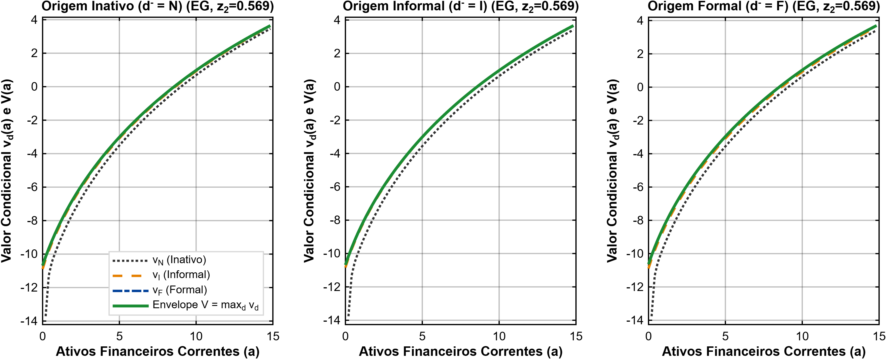

## Introdução e Motivação

A macroeconomia quantitativa com modelos de agentes heterogêneos e mercados incompletos (na tradição de Bewley, Huggett e Aiyagari) defronta-se frequentemente com elevado custo computacional em espaços de estados contínuos e discretos. Quando modelos de agentes heterogêneos incorporam escolhas discretas — como participação no mercado de trabalho ou escolha entre setores formal e informal — juntamente com acumulação contínua de riqueza, a função valor pode apresentar quinas e não concavidades locais nos limiares de indiferença ocupacional. Essas irregularidades podem comprometer a monotonicidade necessária à construção da grade endógena e exigem cuidados adicionais na implementação do EGM.

Tradicionalmente, a literatura recorre à **Iteração da Função Valor (VFI)** com busca exaustiva sobre grades discretas em $(a, a')$, cujo custo cresce rapidamente com a resolução da malha de ativos e onera a busca pelo equilíbrio geral dos preços de fatores. A questão metodológica central deste projeto é responder: *sob escolhas ocupacionais determinísticas ($s_\varepsilon = 0$) e custos fixos de transição ($\bar\chi = 0{,}05$), em que condições surgem dobras na grade endógena, e como a VFI e o DC-EGM com Upper Envelope se comparam em estabilidade iterativa, tempo de execução, fechamento do equilíbrio geral e distribuição estacionária de riqueza?*

Para respondê-la, implementamos e comparamos dois métodos numéricos em um modelo canônico discreto-contínuo:
1. **Value Function Iteration (VFI)** vetorizada clássica;
2. **Discrete-Continuous Endogenous Grid Method (DC-EGM)** estendido com poda geométrica por **Upper Envelope** (Iskhakov et al., 2017), que reduz substancialmente o custo da busca contínua ao inverter analiticamente a Equação de Euler — embora não elimine a maldição da dimensionalidade em modelos com espaços de estados mais amplos.

Investigamos o comportamento do DC-EGM sob escolhas ocupacionais determinísticas ($s_\varepsilon = 0$) e custos fixos de transição ($\bar\chi = 0{,}05$). Os experimentos identificam dobras na grade endógena em determinadas configurações de equilíbrio parcial, a partir de $N_a = 800$. Em termos computacionais, o DC-EGM apresenta desempenho superior à VFI nas grades mais refinadas — alcançando *speedup* de **7,65x** em equilíbrio parcial ($N_a = 1600$) e de **3,49x** no experimento de equilíbrio geral ($N_a = 400$) —, mas mostra desempenho inferior em equilíbrio parcial na malha mais grossa ($N_a = 400$, `0,58x`, sem convergência estrita a $10^{-7}$ em 1.500 iterações). Os resultados evidenciam que desempenho e precisão do método dependem da discretização e das condições econômicas consideradas.

---

## Ambiente Econômico e Problema Dinâmico

A economia é habitada por um contínuo de famílias heterogêneas e uma firma representativa com tecnologia Cobb-Douglas em equilíbrio competitivo estacionário:

- **Preferências:** Função utilidade CRRA $u(c) = \frac{c^{1-\sigma} - 1}{1 - \sigma}$ com aversão relativa ao risco $\sigma = 2{,}00$ e fator de desconto intertemporal $\beta = 0{,}96$.
- **Decisão Contínua:** Poupança ótima em ativos líquidos $a' \in [0, \bar{a}]$ com $\bar{a} = 80{,}00$, sujeita à restrição estrita de endividamento (*borrowing constraint*).
- **Decisão Discreta Ocupacional ($d \in \{N, I, F\}$):**
  - $d = N$: Inatividade ($y_N = 0$, desutilidade $\psi_N = 0{,}00$);
  - $d = I$: Setor Informal ($y_I(z) = \kappa w z$, com $\kappa = 0{,}72$, sem tributação, desutilidade $\psi_I = 0{,}05$);
  - $d = F$: Setor Formal ($y_F(z) = (1 - \tau) w z$, com $\tau = 0{,}20$, desutilidade $\psi_F = 0{,}08$).
- **Fricção de Mercado:** Custo fixo de transição $\chi(d, d^-) = \bar\chi \cdot \mathbf{1}_{\{d \neq d^-\}}$, com $\bar\chi = 0{,}05$ em unidades de utilidade.
- **Risco Idiossincrático:** Produtividade $z$ governada por processo AR(1) em log discretizado via método de Rouwenhorst (1995) com persistência $\rho = 0{,}90$, desvio-padrão da inovação $\sigma_\varepsilon = 0{,}20$ e $N_z = 5$ estados (normalizados para $\mathbb{E}[z] = 1$).
- **Tecnologia Agregada e Governo:** Função de produção $Y = A K^\alpha L^{1-\alpha}$ com $A = 1{,}00$, $\alpha = 0{,}36$ e depreciação anual $\delta = 8\%$; a arrecadação sobre o trabalho formal financia gasto público improdutivo $G = \tau w L_F$.

### O Problema Intertemporal do Agente

Como a escolha ocupacional corrente implica custo de transição caso difira do estado anterior, a ocupação passada $d^-$ integra o vetor de estados individuais $(a, z, d^-)$. O problema recursivo do agente escreve-se em dois estágios:

$$V(a, z, d^-) = \max_{d \in \{N, I, F\}} \left\{ v_d(a, z, d^-) \right\}$$

em que, condicionada a cada alternativa discreta $d$, a função valor contínua satisfaz:

$$v_d(a, z, d^-) = \max_{a' \in [0, \bar{a}]} \left\{ u(c) - \psi_d - \chi(d, d^-) + \beta\,\mathbb{E}\left[ V(a', z', d) \mid z \right] \right\}$$

sujeito à restrição orçamentária e à positividade do consumo:

$$c + a' = (1 + r)a + y_d(z), \qquad c > 0.$$

Economicamente, a formulação em dois estágios separa decisões de naturezas distintas: fixar a ocupação $d$ isola um problema padrão de consumo e poupança, enquanto o envelope externo $\max_d \{v_d(a, z, d^-)\}$ seleciona o setor considerando o ganho intertemporal líquido da desutilidade $\psi_d$ e do custo de transição $\bar\chi$. Como permanecer em $d^-$ evita incorrer em $\bar\chi = 0{,}05$, a ocupação passada gera histerese e zonas de inércia nas escolhas setoriais.

Condicionada a cada ramo $d \in \{N, I, F\}$, a decisão ótima contínua $a' \in [0, \bar{a}]$ obedece às condições de Kuhn-Tucker em três regimes: (i) **canto inferior** ($a' = 0$, restrição de liquidez ativa), quando $u'((1+r)a + y_d(z)) \ge \beta(1+r)\mathbb{E}[V_a(0, z', d) \mid z]$; (ii) **regime interior** ($0 < a' < \bar{a}$), em que vigora a Equação de Euler $u'(c) = \beta(1+r)\mathbb{E}[V_a(a', z', d) \mid z]$; e (iii) **canto superior** ($a' = \bar{a}$), limitado pelo teto da grade de ativos.

---

## Métodos Numéricos e Diagnóstico de Não-Concavidade (EP vs. EG)

Para cada escolha discreta $d \in \{N, I, F\}$ e estado exógeno $z$, o método inverte analiticamente a Equação de Euler sobre a grade de ativos futuros $a'$, definindo os pontos endógenos:

$$a_{\text{endog}}(a') = \frac{(u')^{-1}\!\left(\beta (1+r) \mathbb{E}\left[V_a(a', z', d) \mid z\right]\right) + a' - y_d(z)}{1+r}.$$

Os custos fixos de transição $\bar\chi$ e o operador $\max_d$ geram cruzamentos entre as funções valor condicionais $v_d(a)$, produzindo **pontos de quina** (*kinks*) nos limiares de indiferença ocupacional. Dependendo das inclinações relativas dos ramos antes e depois do cruzamento, esses encontros podem gerar regiões localmente não côncavas, identificadas numericamente pelo diagnóstico de segunda diferença finita positiva ($\Delta^2 V > 0$ sob a convenção padrão $V_{i+1} - 2V_i + V_{i-1} > 0$), como ilustra a Figura 1. Quando $a_{\text{endog}}(a')$ deixa de ser monotônica ($da_{\text{endog}}/da' < 0$), múltiplos níveis de poupança $a'$ satisfazem a condição de primeira ordem para o mesmo ativo inicial $a$. Nesse contexto, o algoritmo **Upper Envelope** (Iskhakov et al., 2017) opera em três etapas encadeadas:

1. **Construção dos ramos condicionais:** resolve o EGM separadamente para cada $d \in \{N, I, F\}$ e particiona a sequência $(a_{\text{endog}}, c_{\text{endog}}, a')$ nos índices de reversão ($\Delta a_{\text{endog}} \le 0$), isolando segmentos estritamente monótonos.
2. **Identificação das dobras e regiões de cruzamento:** interpola cada segmento monótono apenas sobre seu suporte ativo, expondo as faixas em que múltiplos valores de ativos futuros se sobrepõem sobre os mesmos ativos iniciais $a$.
3. **Seleção global e poda:** avalia a função valor completa $v^{(r)}(a_i)$ associada a cada segmento admissível na grade exógena (junto aos cantos exatos $a' = 0$ e $a' = 80$ via Kuhn-Tucker) e preserva o candidato que maximiza a utilidade em cada nó $a_i$. Dessa forma, o *Upper Envelope* não é apenas uma correção gráfica: ele participa diretamente da recuperação da solução global do problema de otimização sem impor artificialmente a concavidade de $V$.

  
  
<em>Figura 1: Funções valor condicionais ($N, I, F$) e envelope superior em equilíbrio geral ($N_a = 400$, $z_2 = 0{,}569$), exibindo quinas nos pontos de indiferença ocupacional.</em>

  
  
<em>Figura 2: Diagnóstico das grades endógenas sob custos fixos de transição ($\bar\chi = 0{,}05$, $s_\varepsilon = 0$), comparando equilíbrio parcial ($N_a = 800$ e $N_a = 1600$, com dobras) e equilíbrio geral ($N_a = 400$, estritamente monotônica).</em>

  
  
<em>Figura 3: Anatomia do algoritmo Upper Envelope na dobra interior em equilíbrio parcial ($z_2, d=I, N_a=1600$), destacando a sobreposição de ramos, o cruzamento em $a^* = 74{,}5093$ e o salto ótimo no consumo.</em>

**Contraste entre Equilíbrio Parcial e Equilíbrio Geral:** Os experimentos de equilíbrio parcial ($r = 4{,}1667\%$, $w = 1{,}1781$) identificam dobras na grade endógena a partir de $N_a = 800$, com aumento de ocorrências sob refinamento da discretização: nenhuma dobra discreta em $N_a = 400$, duas dobras em $N_a = 800$ e quatro dobras em $N_a = 1600$ (três interiores em torno de $a' \approx 60{,}5$, $64{,}5$ e $74{,}4$ e uma próxima à fronteira superior em $a' \in [78{,}55;\, 80{,}0]$). Entretanto, essas dobras não são uma propriedade universal da parametrização: na solução de equilíbrio geral examinada com $N_a = 400$ ($r^* \approx 2{,}80\%$), todas as grades endógenas permaneceram estritamente monotônicas, com incrementos mínimos positivos de $+0{,}1583$ na inatividade, $+0{,}1237$ na informalidade e $+0{,}1313$ na formalidade.

---

## Resultados Computacionais e Escalabilidade

### 1. Refinamento Multigrade no Modelo Canônico ($\bar\chi = 0{,}05$, EP)

| $N_a$ | Iter. (VFI / DC) | Conv. DC ($10^{-7}$) | VFI (s) | DC-EGM (s) | Speedup | Conc. $d^*$ | Dobras |
| :---: | :---: | :---: | :---: | :---: | :---: | :---: | :---: |
| 400 | 376 / 1.500 | Não (teto) | 2,914 | 4,990 | 0,58x | 99,27 % | 0 |
| 800 | 376 / 376 | Sim | 10,591 | 2,530 | 4,19x | 99,78 % | 2 |
| 1.600 | 376 / 376 | Sim | 39,749 | 5,199 | **7,65x** | **99,97 %** | 4 |

- Na malha básica ($N_a = 400$), o DC-EGM leva **4,990 s** contra **2,914 s** da VFI (**0,58x**) e atinge o teto de 1.500 iterações sem alcançar a tolerância de convergência ($10^{-7}$), encerrando com resíduo final de Cauchy $\|\Delta V\|_\infty = 2{,}09 \times 10^{-6}$ (e $\|\Delta c\|_\infty = 5{,}80 \times 10^{-4}$).
- A partir de $N_a = 800$, ambos os métodos convergem estritamente em 376 iterações; em $N_a = 1600$ (24.000 pontos no espaço de estados), o DC-EGM cai de **39,749 s** para **5,199 s** (**speedup de 7,65x**, com razão de tempo de `2,05x` ao dobrar a malha de $N_a = 800$ para $1600$), mantendo concordância ocupacional de **99,97%** e diferenças em norma do supremo $\|\Delta V\|_\infty = 0{,}0156$ e $\|\Delta c\|_\infty = 0{,}0525$.

O desempenho inferior do DC-EGM em $N_a = 400$ não deve ser interpretado como característica geral do método: sob escolhas determinísticas ($s_\varepsilon = 0$) e grade mais grossa, ocorre **ciclagem residual de um nó isolado de fronteira ocupacional**, levando o algoritmo ao limite de 1.500 iterações sem cumprir o critério estrito de $10^{-7}$. Com o refinamento para $N_a \ge 800$, a solução iterativa estabiliza-se em 376 iterações e o ganho da inversão analítica da Equação de Euler torna-se evidente. Cabe observar, contudo, que os *speedups* medidos (`4,19x` e `7,65x`) representam resultados empíricos finitos dessa implementação específica contra a VFI vetorizada de força bruta — como estado ($a$) e controle ($a'$) são refinados simultaneamente com $N_a$, a comparação finita não constitui prova assintótica isolada da complexidade da busca contínua.

  
  
<em>Figura 4: Mapa espacial de escolha ocupacional ótima $d^*(a, z, d^-)$ e regiões de histerese em equilíbrio parcial ($N_a = 1600$, concordância de 99,97% com a VFI).</em>

  
  
<em>Figura 5: Políticas ótimas de consumo $c^*(a)$ e poupança líquida $a'(a)-a$ em equilíbrio parcial convergido ($N_a = 1600$, $\bar\chi = 0{,}05$), evidenciando suavização precaucional, salto discreto na troca ocupacional ($a \approx 60{,}5$) e restrição de liquidez.</em>

### 2. Benchmark Histórico Complementar ($\bar\chi = 0$, Modelo Preliminar)

Em experimento complementar separado sobre o modelo preliminar **sem custos de transição** ($\bar\chi = 0$, $N_a = 400$), o **DC-EGM Otimizado** obtém mediana de **1,661 s** (`4,23x` mais rápido que a VFI vetorizada de referência) e resíduo médio na Equação de Euler de **$7{,}18 \times 10^{-7}$**, frente a **$1{,}88 \times 10^{-3}$** mesmo na VFI refinada com 3.200 pontos candidatos (`91,149 s`).

> **Ressalva metodológica:** Esses valores de erro de Euler pertencem exclusivamente ao benchmark preliminar sem custos de transição ($\bar\chi = 0$) e não devem ser interpretados como medida direta de acurácia do modelo canônico ($\bar\chi = 0{,}05$). Na presença de escolhas discretas e não-concavidades locais, a precisão numérica exige avaliação diferenciada nas vizinhanças de restrições de liquidez e limiares de transição ocupacional.

  
  
<em>Figura 6: Benchmark histórico complementar ($\bar\chi = 0$, modelo preliminar, $N_a = 400$): fronteira tempo de execução versus erro médio de Euler entre 9 implementações.</em>

---

## Equilíbrio Geral Competitivo e Distribuição Estacionária ($N_a = 400$)

### 1. Construção da Distribuição Estacionária (Método de Young, 2010)

Para evitar ruído amostral de simulações estocásticas de Monte Carlo durante a busca iterativa (bisseção) pelos preços de equilíbrio geral, a distribuição estacionária de massa $\mu(a, z, d^-)$ é obtida deterministicamente em histograma discreto pelo método não-estocástico de Young (2010) em `distribuicao_estacionaria.m`:

1. **Loteria linear sobre a grade de ativos:** dado o ativo futuro ótimo $a'(a_i, z_j, d^-)$, quando $a'$ cai no intervalo entre dois nós adjacentes $[a_k, a_{k+1}]$, a massa probabilística é repartida proporcionalmente às distâncias aos dois pontos vizinhos ($\omega = 1 - \frac{a' - a_k}{\Delta a} \in [0, 1]$ para $a_k$ e $1 - \omega$ para $a_{k+1}$).
2. **Transição de produtividade e ocupação:** a produtividade exógena evolui segundo a matriz de Markov $\Pi(z, z')$ de Rouwenhorst, enquanto a escolha ocupacional ótima corrente $d^*(a, z, d^-)$ atualiza o estado de ocupação passada $d^-$ do período seguinte.
3. **Iteração da matriz esparsa:** combina-se $(P_d, \omega, \Pi)$ na matriz de transição esparsa $T$ ($N_{\text{estados}} \times N_{\text{estados}}$, com no máximo 30 transições não nulas por linha) e itera-se deterministicamente a densidade discreta até a convergência estrita:

$$\omega = 1 - \frac{a' - a_k}{\Delta a}, \qquad \mu^{(m+1)} = \mu^{(m)} T, \qquad \left\|\mu^{(m+1)} - \mu^{(m)}\right\|_\infty < 10^{-10}.$$

A partir da distribuição estacionária $\mu$, obtêm-se a oferta agregada de capital $K_s(k) = \sum a\,\mu$ e o trabalho efetivo $L_s(k) = L_I + L_F$. Na firma competitiva, $k \equiv K/L$ determina $r(k) = \alpha A k^{\alpha-1} - \delta$ e $w(k) = (1-\alpha) A k^\alpha$, fechando o equilíbrio geral quando o excesso relativo de demanda/oferta de capital $f(k) = K_s(k)/L_s(k) - k$ anula-se dentro da tolerância.

### 2. Solução de Equilíbrio Geral e Comparação Distributiva

Os resultados a seguir comparam as soluções obtidas pelos dois procedimentos de busca do equilíbrio geral. Embora as diferenças relativas nos agregados reais fiquem abaixo de **$0{,}5\%$** (com discrepância de **$0{,}633\%$**, ou $1{,}8\text{ pb}$, na taxa de juros $r^*$), essa proximidade macroeconômica não se traduz em igual proximidade distributiva: o coeficiente de Gini da riqueza diverge em **$3{,}38\%$** e a massa concentrada na restrição de liquidez varia expressivamente.

| Variável / Critério | DC-EGM | VFI Vetorizada | Discrepância / Status |
| :--- | :---: | :---: | :---: |
| Razão Capital-Trabalho ($k^*$) | 6,564697 | 6,547806 | 0,258 % |
| Taxa Real de Juros ($r^*$) | 2,7966 % | 2,8144 % | 0,633 % (1,8 pb) |
| Salário Real Competitivo ($w^*$) | 1,260020 | 1,258851 | 0,093 % |
| Estoque Agregado de Capital ($K^*$) | 6,5349 | 6,5147 | 0,310 % |
| Trabalho Efetivo Agregado ($L^*$) | 0,9956 | 0,9947 | 0,090 % |
| Produto Agregado ($Y^*$) | 1,9600 | 1,9567 | 0,169 % |
| Consumo Agregado ($C^*$) | 1,1892 | 1,1885 | 0,055 % |
| Investimento Agregado ($I^*$) | 0,5228 | 0,5212 | 0,309 % |
| Gasto do Governo ($G^*$) | 0,2480 | 0,2470 | 0,418 % |
| Coeficiente de Gini de Riqueza | 0,4948 | 0,5115 | 3,38 % |
| Massa na Restrição de Liquidez ($a = 0$) | 5,03 % | 14,09 % | 9,06 pp |
| Participação no Setor Formal ($M_F$) | 98,28 % | 97,96 % | 0,32 pp |
| Resíduo Relativo de Mercado ($\lvert f(k)\rvert/k$) | $9{,}76 \times 10^{-5}$ | $2{,}88 \times 10^{-4}$ | Tol. $10^{-4}$: Sim (DC) / Não (VFI) |
| Resíduo Contábil de Walras | $-1{,}68 \times 10^{-8}$ | $-2{,}47 \times 10^{-8}$ | Consistência contábil |
| **Tempo Total em EG (Iter.)** | **7,61 s (11 iter.)** | **26,60 s (15 iter.)** | **3,49x mais rápido** |

> **Fechamento de mercado vs. identidade contábil de Walras:** Os dois resíduos medem coisas distintas e não devem ser confundidos. O **resíduo relativo de mercado** ($\lvert f(k)\rvert/k$) testa se a oferta agregada de ativos das famílias iguala a demanda de capital da firma: em `equilibrio_geral_dc_egm.m`, o DC-EGM atinge $9{,}76 \times 10^{-5} < 10^{-4}$ na 11ª iteração; já em `equilibrio_geral_vfi.m`, a discretização da escolha $a'$ cria um platô discreto que congela $\lvert f(k)\rvert/k = 2{,}88 \times 10^{-4}$ entre as iterações 12 e 15, encerrando a bisseção pelo critério auxiliar de largura do intervalo ($\lvert k_b - k_a\rvert = 9{,}15 \times 10^{-5} < 10^{-4}$) sem cumprir a tolerância de equilíbrio de capital. O **resíduo de Walras** ($Y - C - I - G$, de ordem $10^{-8}$) verifica apenas a consistência contábil das restrições orçamentárias e não indica que os dois algoritmos fecharam o equilíbrio geral com igual precisão.

**Discrepâncias de políticas e interpretação econômica em EG ($N_a = 400$) vs. EP ($N_a = 1600$):** Economicamente, a taxa real de juros ligeiramente inferior obtida no DC-EGM ($2{,}7966\%$ contra $2{,}8144\%$ na VFI) associa-se a um estoque agregado de capital $0{,}310\%$ maior ($K^* = 6{,}5349$ vs. $6{,}5147$) e a uma menor concentração de riqueza na base e no Gini ($0{,}4948$ vs. $0{,}5115$), enquanto salário real e trabalho efetivo variam abaixo de $0{,}10\%$. No plano numérico, as diferenças em norma do supremo entre as soluções finais dos dois métodos no EG atingem $\|\Delta V\|_\infty = 0{,}2419$, $\|\Delta c\|_\infty = 0{,}1606$ e $\|\Delta a'\|_\infty = 0{,}1611$ (exibidas na aba *Políticas (EG)* do laboratório abaixo). Esses valores medem divergência entre métodos — não erros de convergência — e superam as diferenças registradas em EP com $N_a = 1600$ ($\|\Delta V\|_\infty = 0{,}0156$; $\|\Delta c\|_\infty = 0{,}0525$) porque o EG combina malha quatro vezes mais grossa ($\Delta a \approx 0{,}20$ contra $0{,}05$) com preços competitivos finais distintos em $1{,}8\text{ pb}$, enquanto o experimento multigrade em EP compara os dois métodos exatamente aos mesmos preços ($r = 4{,}1667\%$).

  
  
<em>Figura 7: Comparação entre VFI e DC-EGM na função valor $V(a,z,d^-)$ e na política de poupança $a'(a,z,d^-)$ em equilíbrio geral ($N_a = 400$, malha uniforme $a \in [0, 80]$).</em>

  
  
<em>Figura 8: Densidade marginal estacionária de ativos $\mu_a(a)$ e distribuição acumulada (CDF) em equilíbrio geral ($N_a = 400$), evidenciando a concentração de massa na restrição $a = 0$ (5,03% no DC-EGM vs. 14,09% na VFI).</em>

- **Concentração na Base e Efeito da Discretização:** Na VFI, a escolha de ativos futuros restringe-se exatamente aos nós da malha ($\omega = 1$ na loteria linear), enquanto o DC-EGM permite escolhas contínuas posteriormente interpoladas entre nós adjacentes ($\omega \in (0, 1)$). Essa diferença de projeção em `distribuicao_estacionaria.m` contribui para concentrar massa em pontos discretos na densidade da VFI (visível nos picos locais da Figura 8 e nos $14{,}09\%$ em $a = 0$) e suavizar $\mu(a)$ no DC-EGM ($5{,}03\%$ em $a = 0$); contudo, como políticas de poupança e juros de equilíbrio ($r^*$) também diferem entre os dois algoritmos, não é possível atribuir toda a divergência distributiva exclusivamente ao efeito de interpolação.
- **Composição Ocupacional (EP $\to$ EG):** Sob os preços iniciais de equilíbrio parcial ($r = 4{,}1667\%$, $w = 1{,}1781$), a informalidade concentra $86{,}99\%$ dos agentes. Nos preços competitivos de equilíbrio geral ($w^* = 1{,}2600$, $r^* = 2{,}80\%$), a participação formal eleva-se para $98{,}28\%$ no DC-EGM ($97{,}96\%$ na VFI, com $M_N = 4{,}17 \times 10^{-14}$). Esse percentual próximo de $98\%$ decorre da parametrização canônica e dos preços competitivos adotados no exercício, não devendo ser interpretado como estimativa empírica da economia brasileira.

---

## Laboratório Numérico Interativo (JS/HTML)

Explore diretamente no navegador as funções políticas de equilíbrio geral, as dobras e o descarte de ramos subótimos no *Upper Envelope* ($N_a = 1600$), a distribuição estacionária de riqueza e os *benchmarks* multigrade e histórico de Euler. Por eficiência e fidelidade aos experimentos, o painel carrega localmente matrizes e séries numéricas **pré-computadas diretamente em MATLAB** ([`dc_egm_vfi_interactive.json`](../materials/dc_egm_vfi/dc_egm_vfi_interactive.json)), renderizadas em tempo real em HTML5 `<canvas>` sem reexecutar o solver iterativo no navegador.

<noscript>Ative o JavaScript para usar o visualizador numérico interativo de VFI vs. DC-EGM.</noscript>

---

## Limitações Numéricas e Transparência Metodológica

1. **Ciclagem residual em $N_a = 400$ (EP, $s_\varepsilon = 0$):** Sem suavização por choques de gosto Gumbel, um nó isolado de fronteira oscila entre ocupações e leva o DC-EGM ao teto de 1.500 iterações ($\|\Delta V\|_\infty = 2{,}09 \times 10^{-6} > 10^{-7}$). Em $N_a \in \{800, 1600\}$, converge estritamente em 376 iterações mantendo dobras interiores e junto ao teto.
2. **Platô discreto da VFI na bisseção em EG:** A quantização de $a'$ sobre a malha discreta congela o excesso relativo em $\lvert f(k)\rvert/k = 2{,}88 \times 10^{-4}$ entre as iterações 12 e 15; o algoritmo encerra pela largura do intervalo ($\lvert k_b - k_a\rvert = 9{,}15 \times 10^{-5}$), sem cumprir a tolerância de mercado ($10^{-4}$).
3. **Grade uniforme $[0, 80]$ e argumento `kinks_cand`:** Aproximadamente dois terços dos nós da grade recaem acima do percentil $P_{99} = 26{,}7$; além disso, a rotina implementa suporte opcional para inserção de pontos de quebra (`kinks_cand`), mas esse argumento não é acionado na execução padrão.
4. **Sensibilidade de dobras e acurácia não uniforme:** A ocorrência de dobras manifestou-se no experimento de EP ($N_a \in \{800, 1600\}$), mas esteve ausente na solução de EG examinada com $N_a = 400$ (sem generalização automática para malhas mais finas em EG sem testes adicionais). Sob $\bar\chi = 0{,}05$, erros numéricos tendem a concentrar-se próximo à restrição $a = 0$ e aos limiares de transição ocupacional.
5. **Escopo empírico do benchmark e refinamento conjunto:** Os tempos observados (incluindo a razão de `2,05x` ao passar de $N_a = 800$ para $1600$ e o *speedup* de `7,65x`) referem-se a testes finitos contra a VFI vetorizada de força bruta refinando estado ($a$) e controle ($a'$) simultaneamente; variantes aceleradas como VFI monotônica ou Howard não foram medidas em $\bar\chi = 0{,}05$. Na bisseção de EG, os passos acumulados do algoritmo de Young (2010) somam `7.645` iterações na VFI contra `6.109` no DC-EGM.
6. **Separação do benchmark histórico e calibração ilustrativa:** Os resíduos de Euler de $7{,}18 \times 10^{-7}$ pertencem exclusivamente ao benchmark preliminar ($\bar\chi = 0$), no qual a VFI com 3.200 candidatos atinge Bellman MAE ligeiramente inferior ($2{,}92 \times 10^{-5}$ contra $3{,}56 \times 10^{-5}$, em `91,149 s`). A participação formal próxima de $98\%$ decorre da parametrização canônica adotada, sem estimação empírica aplicada ao mercado de trabalho brasileiro.

---

## Implicações Metodológicas: Quando Usar VFI ou DC-EGM?

### Quando utilizar VFI

- **Prototipagem inicial de modelos com novas fricções:** adequada na fase exploratória em que há múltiplas não convexidades estruturais, antes de derivar condições marginais analíticas.
- **Controles contínuos múltiplos e acoplados:** problemas em que a inversão fechada da Equação de Euler por ramo discreto torna-se analiticamente intratável.
- **Oráculo global de auditoria:** referência numérica independente para verificar se um método baseado em condições de primeira ordem perdeu algum máximo global em regiões com dobras.

### Quando utilizar DC-EGM com Upper Envelope

- **Decisão discreta combinada à poupança contínua:** modelos de ciclo de vida, escolha ocupacional, aposentadoria, habitação ou *default* envolvendo um ativo líquido sem custo de ajustamento.
- **Equilíbrio geral e precisão na cauda pobre:** situações em que a suavidade de $f(k)$ durante a bisseção e a ausência de viés de quantização junto à restrição de liquidez ($a = 0$) são decisivas — mantendo a ressalva de que o erro médio de Euler de $7{,}18 \times 10^{-7}$ reportado acima pertence ao benchmark histórico $\bar\chi = 0$.

### Alternativas e extensões na literatura

- **Sem inversão analítica de Euler:** *VFI com busca estrutural (Divide-and-Conquer)* explora monotonicidade por trechos reduzindo o custo empírico da busca para escala $\mathcal{O}(N_a \log N_a)$; *Modified Policy Iteration* (Howard) alterna poucos passos caros de maximização com atualizações lineares baratas mantendo a política fixa; *Time Iteration / Policy Function Iteration (PFI)* resolve as condições de otimalidade via buscadores de raízes sobre a grade fixa.
- **Múltiplos ativos e alta dimensão:** o *EGM Generalizado e Aninhado (G²EGM e NEGM)* (Druedahl & Jørgensen, 2017; Druedahl, 2021) combina busca numérica nas dimensões sem inversão com passo analítico de EGM no ativo líquido; métodos de *projeção/colocação* (polinômios de Chebyshev ou *splines*) atingem alta acurácia em modelos suaves multidimensionais; e técnicas sem grade baseadas em redes neurais (*Deep Equilibrium / Neural VFI*) lidam com espaços de estado de alta dimensão ($d \gg 3$).

---

## Materiais Didáticos, Reprodutibilidade e Downloads

Projeto validado em **MATLAB R2026b Update 1** (compatível com R2020b+), com ponto de entrada único `executar_projeto.m` na raiz de `Projeto_D-EGM/`, documentação interna (`README.md` e pasta `documentacao/`) e bateria de **11 testes automatizados** formais aprovados (`log_execucao_modelo.txt`):

- 🖥️ **[Slides — Apresentação Oficial Beamer 16:9 (PDF)](../materials/dc_egm_vfi/APRESENTACAO_DC_EGM_VFI.pdf)**: Versão oficial final cobrindo teoria, condições KKT, implementação em MATLAB e resultados de equilíbrio geral (64 slides).
- 📦 **[Códigos de Implementação MATLAB (.zip)](../materials/dc_egm_vfi/Projeto_D-EGM.zip)**: Estrutura modular em `Projeto_D-EGM/` com `executar_projeto.m`, `README.md`, `documentacao/` e subpastas temáticas (`parametros/`, `codigos/`, `figuras/` e `resultados/`).

  

    
Dicionário de dados do laboratório interativo (<code class="notranslate" translate="no">dc_egm_vfi_interactive.json</code>)

    <ul class="course-syllabus-list">
      <li><code class="notranslate" translate="no">meta</code>: parâmetros e eixos comuns — vetor de choques <code class="notranslate" translate="no">z</code> (5 estados), rótulos em <code class="notranslate" translate="no">occupations</code>, grades <code class="notranslate" translate="no">a_sampled</code> e <code class="notranslate" translate="no">a_full</code>, além de <code class="notranslate" translate="no">params</code> (calibração canônica).</li>
      <li><code class="notranslate" translate="no">equilibrio_geral</code>: tolerância <code class="notranslate" translate="no">tol_k</code>, contagem <code class="notranslate" translate="no">dobras_eg</code>, incremento mínimo <code class="notranslate" translate="no">min_inc_eg</code>, blocos <code class="notranslate" translate="no">dc</code> e <code class="notranslate" translate="no">vfi</code> (<code class="notranslate" translate="no">resumo</code>, <code class="notranslate" translate="no">historico</code> de bisseção, densidade marginal <code class="notranslate" translate="no">mu_a</code>, função valor <code class="notranslate" translate="no">V</code>, consumo <code class="notranslate" translate="no">c</code>, poupança <code class="notranslate" translate="no">ap</code>, ocupação <code class="notranslate" translate="no">d_star</code> e valores condicionais <code class="notranslate" translate="no">v_cond</code>) e métricas de <code class="notranslate" translate="no">discrepancias</code> (<code class="notranslate" translate="no">dif_sup_V</code>, <code class="notranslate" translate="no">dif_sup_c</code>, <code class="notranslate" translate="no">dif_sup_ap</code>, <code class="notranslate" translate="no">speedup_eg</code>).</li>
      <li><code class="notranslate" translate="no">dobras_ep</code>: diagnóstico detalhado das dobras em equilíbrio parcial (<code class="notranslate" translate="no">na</code>, <code class="notranslate" translate="no">r_pct</code>, <code class="notranslate" translate="no">w</code>, <code class="notranslate" translate="no">total_dobras</code>, <code class="notranslate" translate="no">na400_erro_V</code>, visão geral <code class="notranslate" translate="no">overview</code> e array <code class="notranslate" translate="no">folds</code> com curvas <code class="notranslate" translate="no">fold_a_prime</code>, <code class="notranslate" translate="no">fold_a_endo</code>, <code class="notranslate" translate="no">fold_c_endo</code> e dados de poda em <code class="notranslate" translate="no">envelope</code>).</li>
      <li><code class="notranslate" translate="no">benchmarks</code>: tabelas <code class="notranslate" translate="no">multigrade</code> (<code class="notranslate" translate="no">Na</code>, iterações, tempos, <code class="notranslate" translate="no">Speedup</code>, <code class="notranslate" translate="no">Concordancia_Ocup_pct</code>, <code class="notranslate" translate="no">Dobras_Grade_Endogena_Final</code>), agregados <code class="notranslate" translate="no">macro</code> e comparativo <code class="notranslate" translate="no">historico9</code> (<code class="notranslate" translate="no">Implementacao</code>, <code class="notranslate" translate="no">Mediana_s</code>, <code class="notranslate" translate="no">Euler_Erro_Consumo</code>, <code class="notranslate" translate="no">Bellman_MAE</code>).</li>
    </ul>
  

---

## Referências Bibliográficas

1. **Aiyagari, S. R. (1994).** Uninsured Idiosyncratic Risk and Aggregate Saving. *Quarterly Journal of Economics*, 109(3), 659–684.
2. **Bewley, T. (1986).** Stationary Monetary Equilibrium with a Continuum of Independently Fluctuating Consumers. *Contributions to Mathematical Economics*, 79–102.
3. **Carroll, C. D. (2006).** The Method of Endogenous Gridpoints for Solving Dynamic Stochastic Optimization Problems. *Economics Letters*, 91(3), 312–320.
4. **Druedahl, J. (2021).** A Guide on Solving Non-Convex Consumption-Saving Models. *Computational Economics*, 58, 747–775.
5. **Druedahl, J., & Jørgensen, T. H. (2017).** A General Endogenous Grid Method for Multi-Dimensional Models with Non-Convexities and Constraints. *Journal of Economic Dynamics and Control*, 74, 87–107.
6. **Huggett, M. (1993).** The Risk-Free Rate in Heterogeneous-Agent Incomplete-Insurance Economies. *Journal of Economic Dynamics and Control*, 17(5-6), 953–969.
7. **Iskhakov, F., Jørgensen, T. H., Rust, J., & Schjerning, B. (2017).** The Endogenous Grid Method for Discrete-Continuous Dynamic Choice Models with (or without) Taste Shocks. *Quantitative Economics*, 8(2), 317–365.
8. **Rouwenhorst, K. G. (1995).** Asset Pricing Implications of Equilibrium Business Cycle Models. *Frontiers of Business Cycle Research*, Princeton University Press.
9. **Young, E. R. (2010).** Solving the Incomplete Markets Model with Aggregate Uncertainty Using the Krusell-Smith Algorithm and Non-Stochastic Simulations. *Journal of Economic Dynamics and Control*, 34(1), 36–41.
